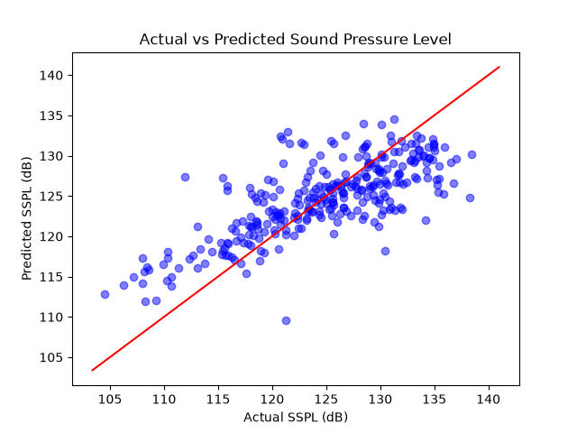

# Airfoil Self-Noise Predictor

Predicts the sound level (decibels) generated by an airfoil based on its physical shape, angle of attack, air speed, and frequency using machine learning (pandas, matplotlib, scikit-learn).

## Team and Roles

| Member | Entry No. | Role | User ID |
| :--- | :--- | :--- | :--- |
| OM GUPTA | 2026ESB1485 | EXECUTION LEAD | omgupta000
| VAISHALI PARMAR| 2026EEB1421 | PPT LEAD | vaishali-parmar21
| ANISH KUMAR RAKESH | 2026MCB1512 | VIDEO LEAD | Anish-0811
| RAJIT GUPTA | 2026EEB1695 | DOCUMENTATION LEAD | rajitgupta1267

---

## Project Structure

```text
ai-project-grp-3/
├── data/
│   └── airfoil_self_noise.csv      # NASA dataset (1503 rows, 6 columns)
├── src/
│   └── main.py                     # Entry point for training and evaluation
├── outputs/
│   └── predicted_vs_actual.png     # Saved evaluation scatter plot
├── .gitignore                      # Ignores virtual environments and cache
├── requirements.txt                # Pinned dependencies
└── README.md                       # Documentation, setup, and execution steps


# 1. Clone the repository
git clone (https://github.com/rajitgupta1267/ai-project-grp-3)
cd ai-project-grp-3

# 2. Create and activate a virtual environment
# On Windows:
python -m venv venv
venv\Scripts\activate

# On macOS/Linux:
python3 -m venv venv
source venv/bin/activate

# 3. Install required packages
pip install -r requirements.txt

# 4. Run the command
python src/main.py

# 5. Expected Output
Dataset shape: (1503, 6)
   Frequency  Angle_of_attack  Chord_length  Velocity  Displacement_thickness     SSPL
0        800              0.0        0.3048      71.3                0.002663  126.201
1       1000              0.0        0.3048      71.3                0.002663  125.201
2       1250              0.0        0.3048      71.3                0.002663  125.951
3       1600              0.0        0.3048      71.3                0.002663  127.591
4       2000              0.0        0.3048      71.3                0.002663  127.461

Coefficients: [-1.0000e-03 -4.0600e-01 -3.4469e+01  9.8000e-02 -1.3946e+02]
Intercept: 132.532
MAE: 3.672
R2 Score: 0.558
RMSE: 4.704

Plot saved to outputs/predicted_vs_actual.png

### Model Evaluation Plot


# 6. Slides


# 7. Video


# 8. AI- use Disclosure
Gemini was used to fix error in src/main.py , given code to save .png image of plotted graph, and given the first draft of readme (edited further). All code and commands were reviewed, tested locally in a fresh virtual environment, and verified on GitHub by us.
